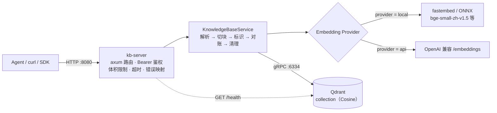

# Qdrant 知识库服务

一个用 Rust 编写、以 [Qdrant](https://qdrant.tech/) 为向量存储的轻量级知识库 REST 服务。它把「文档解析 → 切块 → 向量化 → 写入/对账 → 相似度检索」封装成一套稳定的 HTTP API，支持中文友好的本地 ONNX 模型，也支持任意 OpenAI 兼容的 Embedding API。

## 功能特性

- **两种 Embedding 后端**：进程内 `fastembed`（ONNX，默认，开箱即用）或任意 OpenAI 兼容的 `/embeddings` 端点（OpenAI、通义兼容模式、SiliconFlow、Ollama、vLLM 等）。
- **完整文档管道**：支持 `text`、`markdown`、`html`、`json` 四种格式；Markdown/HTML 按标题感知切块并保留 `heading_path`。
- **中文友好**：按 Unicode 字符数切块，默认 `bge-small-zh-v1.5`（512 维），内置模型推荐的查询/文档前缀。
- **幂等注入与自愈对账**：基于 `content_hash` 与确定性 point id；重复注入跳过 embedding，失败重试可自动补齐/清理残缺数据。
- **元数据与过滤**：`source`、`title`、`tags`、`extra` 元数据；检索可按 `source`、`doc_ids`、`tags_any` 过滤。
- **稳健的 HTTP 层**：Bearer 鉴权（可选）、请求体大小限制、统一超时、稳定的错误码信封。
- **生产可用部署**：多阶段 Dockerfile、Docker Compose（Qdrant + kb-server），数据与模型缓存持久化。
- **Windows 开发友好**：提供一键启动 Qdrant 的 PowerShell 脚本，无需 Docker 即可开发。
- **Rust 可视化工作台**：`kb-dashboard`（Axum）+ `kb-dashboard-ui`（Yew/WASM），实时浏览向量库、运行时接入 OpenAI 兼容 / DashScope 原生嵌入模型，并可视化「输入 → 切块 → 嵌入 → 写入」全过程。

## 架构



- `kb-core`：配置、领域模型、Embedding trait、两种 provider、解析/切块、Qdrant 访问层、业务服务。
- `kb-server`：薄 HTTP 层（axum），负责鉴权、请求限制、错误映射和路由；依赖方向只有 `kb-server -> kb-core`。
- Qdrant 通过 **gRPC（6334）** 访问；REST/Web UI 端口 6333 不用于本服务的 CRUD。

## 目录结构

```
.
├── Cargo.toml / Cargo.lock          # workspace（kb-core + kb-server）
├── Dockerfile                       # 多阶段构建
├── docker-compose.yml               # Qdrant + kb-server
├── .env.example                     # 可选环境变量示例
├── config/
│   └── config.example.toml          # 完整配置模板（复制为 config/config.toml）
├── scripts/
│   ├── start-qdrant.ps1             # Windows：下载并启动 Qdrant v1.20.2
│   └── start-dashboard.ps1          # 一键启动 Qdrant + 可视化工作台
├── crates/
│   ├── kb-core/
│   │   ├── src/
│   │   │   ├── config.rs            # 配置加载/默认值/校验
│   │   │   ├── error.rs             # KbError
│   │   │   ├── models.rs            # 请求/响应/领域类型
│   │   │   ├── service.rs           # 业务逻辑、条带锁、对账
│   │   │   ├── store.rs             # QdrantStore（gRPC 封装）
│   │   │   ├── embedding/
│   │   │   │   ├── mod.rs           # EmbeddingProvider trait
│   │   │   │   ├── api.rs           # OpenAI 兼容实现
│   │   │   │   ├── local.rs         # fastembed/ONNX 实现
│   │   │   │   └── mock.rs          # 确定性测试 provider
│   │   │   └── ingest/
│   │   │       ├── parser.rs        # 文本/HTML/JSON 解析与编码解码
│   │   │       └── chunker.rs       # 标题感知切块
│   │   └── tests/store_service.rs   # 需真实 Qdrant 的集成测试
│   ├── kb-server/
│   │   ├── src/
│   │   │   ├── main.rs              # 启动、配置、信号
│   │   │   ├── lib.rs               # build_embedder（feature 开关）
│   │   │   ├── state.rs             # AppState
│   │   │   ├── error.rs             # KbError -> HTTP 错误信封
│   │   │   └── api/
│   │   │       ├── routes.rs        # 路由、鉴权、中间件
│   │   │       └── handlers.rs      # HTTP handler
│   │   └── tests/api.rs             # axum oneshot HTTP 测试
│   ├── kb-dashboard-types/          # 可视化工作台前后端共享 wire types
│   ├── kb-dashboard/                # 可视化工作台后端（Axum + 静态托管）
│   └── kb-dashboard-ui/             # Yew/WASM 前端（独立 workspace，trunk 构建）
└── docs/
    ├── dashboard.md                 # 可视化工作台使用与协议说明
    └── superpowers/                 # 设计与实施计划
```

## 快速开始

### 前置条件

- Rust stable（已验证 1.100；workspace MSRV 1.92）。
- Windows 构建本地 embedding 需要 **MSVC + Windows SDK**（已验证 VS 2022 Build Tools 可用），首次编译会下载预编译 ONNX Runtime。
- 首次使用本地模型会从 Hugging Face 下载模型文件（默认 `bge-small-zh-v1.5`，约百 MB）。网络受限时设置 `HF_ENDPOINT=https://hf-mirror.com`。

### 方式 A：Windows 本地运行（无需 Docker）

```powershell
# 1. 启动 Qdrant v1.20.2（gRPC 6334 / REST 6333），首次会下载并解压到 .tools\qdrant
powershell -ExecutionPolicy Bypass -File .\scripts\start-qdrant.ps1

# 2. 准备配置（默认使用本地 bge-small-zh-v1.5）
Copy-Item config\config.example.toml config\config.toml

# 3. 可选：国内网络加速模型下载
$env:HF_ENDPOINT = "https://hf-mirror.com"

# 4. 启动服务（首次会下载并加载模型，日志中出现 "embedding provider ready"）
cargo run -p kb-server

# 5. 健康检查
curl.exe -s http://localhost:8080/health
```

健康输出示例：

```json
{"status":"ok","qdrant":"ok","embedding":{"provider":"local","model":"bge-small-zh-v1.5","dimension":512}}
```

Qdrant 未就绪时服务会在 `qdrant.startup_retry_secs`（默认 30 秒）内重试，超时后启动失败。

### 方式 B：Docker Compose

```powershell
# 可选：复制环境变量示例并按需修改（模型、API key、HF 镜像等）
Copy-Item .env.example .env

docker compose up --build
curl.exe -s http://localhost:8080/health
```

- `qdrant` 使用镜像 `qdrant/qdrant:v1.20.2`，数据写入 `./data/qdrant`。
- `kb-server` 构建自本目录的 `Dockerfile`，模型缓存写入 `./data/models`。
- 首次构建需要网络下载 Rust 依赖与 ONNX Runtime；首次启动会下载本地模型。
- 停止服务：`docker compose down`（两个 `./data` 目录会保留，重启后数据仍在）。
- 查看日志：`docker compose logs -f kb-server`。

> **安全警告：不要在没有鉴权的情况下把 Qdrant 暴露到网络。** 默认 compose 只把
> Dashboard/REST 端口绑定到 `127.0.0.1:6333`，并且**不发布** gRPC 端口 6334
> （`kb-server` 通过 Compose 内部网络访问 `http://qdrant:6334`）。Qdrant 本身默认
> 无鉴权；如果确需远程访问，必须为它配置 API key、TLS 或前置一个鉴权代理，
> 并且不要用 `0.0.0.0` 直接发布端口。

## 可视化工作台

项目内置一个 Apple 风格的可视化工作台（Axum + Yew/WASM）：实时查看 Qdrant 中的文档，
在页面里填写嵌入模型的 Base URL 与 API Key，并观察「输入 → 解析切块 → 嵌入 → 写入」
的完整过程。它直接连接 Qdrant（gRPC 6334），不要求 `kb-server` 同时运行。

```powershell
# 首次：安装 WASM 目标与 Trunk
rustup target add wasm32-unknown-unknown
cargo install trunk --locked

# 构建前端
cd crates\kb-dashboard-ui
trunk build --release
cd ..\..

# 启动（默认 http://127.0.0.1:8090）
cargo run -p kb-dashboard
```

或使用一键脚本：

```powershell
powershell -ExecutionPolicy Bypass -File .\scripts\start-dashboard.ps1
```

- 支持 **OpenAI 兼容**（`{base_url}/embeddings`）与 **DashScope 原生**
  （`{base_url}/services/embeddings/text-embedding/text-embedding`）两种协议。
- 页面内置通义 MaaS、OpenAI、SiliconFlow、Ollama 等预设；API Key 仅驻留进程内存，
  不写盘、不写日志。
- 工作台无登录鉴权且会请求用户填写的 Base URL，默认只绑定 `127.0.0.1`，不要直接暴露到公网。
- 详细说明、API 参考与安全注意事项见 [docs/dashboard.md](docs/dashboard.md)。

## 配置说明

配置加载顺序（后者覆盖前者）：

1. 内置默认值；
2. `config/config.toml`（存在则读取；路径相对于进程工作目录）；
3. `KB_` 前缀环境变量，嵌套层级用 `__` 分隔。

配置文件路径可用 `KB_CONFIG` 环境变量或命令行 `--config <path>` / `--config=<path>` 覆盖；显式指定的文件必须存在。

### 完整配置表

| 键 | 默认值 | 环境变量 | 说明 |
|---|---|---|---|
| `server.host` | `0.0.0.0` | `KB_SERVER__HOST` | 监听地址 |
| `server.port` | `8080` | `KB_SERVER__PORT` | 监听端口，必须 > 0 |
| `server.api_key` | `""` | `KB_SERVER__API_KEY` | 非空时 `/v1` 需要 `Authorization: Bearer <key>`；`/health` 不鉴权 |
| `server.max_body_mb` | `32` | `KB_SERVER__MAX_BODY_MB` | 请求体上限（MB），必须 > 0；超出返回 413 |
| `server.request_timeout_secs` | `300` | `KB_SERVER__REQUEST_TIMEOUT_SECS` | 单请求超时（秒），必须 > 0；超时返回 408 |
| `qdrant.url` | `http://localhost:6334` | `KB_QDRANT__URL` | Qdrant **gRPC** 地址，不可用 6333 |
| `qdrant.api_key` | `""` | `KB_QDRANT__API_KEY` | Qdrant Cloud 等场景的 API key |
| `qdrant.timeout_secs` | `30` | `KB_QDRANT__TIMEOUT_SECS` | Qdrant 请求超时 |
| `qdrant.startup_retry_secs` | `30` | `KB_QDRANT__STARTUP_RETRY_SECS` | 启动时等待 Qdrant 就绪的时长 |
| `embedding.provider` | `local` | `KB_EMBEDDING__PROVIDER` | `local` 或 `api` |
| `embedding.batch_size` | `32` | `KB_EMBEDDING__BATCH_SIZE` | 每批 embedding 的文本数 |
| `embedding.max_concurrent_batches` | `4` | `KB_EMBEDDING__MAX_CONCURRENT_BATCHES` | API embedding 并发批次数 |
| `embedding.local.model` | `bge-small-zh-v1.5` | `KB_EMBEDDING__LOCAL__MODEL` | 本地模型别名（见下表） |
| `embedding.local.cache_dir` | `./data/models` | `KB_EMBEDDING__LOCAL__CACHE_DIR` | 模型缓存目录 |
| `embedding.local.show_download_progress` | `true` | `KB_EMBEDDING__LOCAL__SHOW_DOWNLOAD_PROGRESS` | 是否显示下载进度 |
| `embedding.local.max_length` | `512` | `KB_EMBEDDING__LOCAL__MAX_LENGTH` | ONNX 模型最大 token 长度 |
| `embedding.local.warmup` | `true` | `KB_EMBEDDING__LOCAL__WARMUP` | 启动时加载模型；`false` 则首次请求时懒加载 |
| `embedding.local.query_prefix` | `""` | `KB_EMBEDDING__LOCAL__QUERY_PREFIX` | 留空使用模型默认查询前缀 |
| `embedding.local.document_prefix` | `""` | `KB_EMBEDDING__LOCAL__DOCUMENT_PREFIX` | 留空使用模型默认文档前缀 |
| `embedding.api.base_url` | `https://api.openai.com/v1` | `KB_EMBEDDING__API__BASE_URL` | 兼容端点根地址（服务会追加 `/embeddings`） |
| `embedding.api.api_key` | `""` | `KB_EMBEDDING__API__API_KEY` | 为空时不发送 Authorization |
| `embedding.api.model` | `text-embedding-3-small` | `KB_EMBEDDING__API__MODEL` | 模型名 |
| `embedding.api.dimensions` | `0` | `KB_EMBEDDING__API__DIMENSIONS` | `0` 表示启动时用探针请求自动获取维度 |
| `embedding.api.timeout_secs` | `60` | `KB_EMBEDDING__API__TIMEOUT_SECS` | 单次 API 请求超时 |
| `embedding.api.max_retries` | `3` | `KB_EMBEDDING__API__MAX_RETRIES` | 429/5xx/超时的重试次数 |
| `ingest.chunk_size` | `800` | `KB_INGEST__CHUNK_SIZE` | 切块字符数上限（Unicode 字符） |
| `ingest.chunk_overlap` | `120` | `KB_INGEST__CHUNK_OVERLAP` | 相邻块重叠字符数，必须 < `chunk_size` |
| `ingest.min_chunk_size` | `30` | `KB_INGEST__MIN_CHUNK_SIZE` | 小于该值的尾块尝试并入前块 |
| `ingest.upsert_batch_size` | `64` | `KB_INGEST__UPSERT_BATCH_SIZE` | 写入 Qdrant 的批大小 |

> **注意 `ingest.chunk_size` 与 `embedding.local.max_length` 的单位不同：**
> `chunk_size` 按 **Unicode 字符**计数，`max_length` 是模型的 **token** 上限。
> 对中文等 CJK 文本，一个字符通常接近一个 token（这是粗略估算，并非精确换算）。
> 默认 `chunk_size = 800` 大于默认 `max_length = 512`，超长块会被本地模型**静默截断**，
> 块尾内容不参与 embedding。使用 CJK 本地模型时建议把 `chunk_size` 降到 `400` 左右
> （并重新注入已有文档）；服务启动时如果 `provider=local` 且 `chunk_size > max_length`
> 会打印 WARN 日志。

> 环境变量命名规则：`section.key` → `KB_SECTION__KEY`（全大写、层级用双下划线、键名内的下划线保留），例如 `embedding.api.api_key` → `KB_EMBEDDING__API__API_KEY`。布尔值用 `true` / `false`。

启动时会校验配置：端口/超时/批大小必须大于 0，`chunk_overlap < chunk_size`，`min_chunk_size <= chunk_size`；`provider=local` 时模型名不能为空，`provider=api` 时 `base_url` 与 `model` 不能为空。配置非法会直接导致启动失败并在日志中给出原因。

API-only 构建（不编译 fastembed/ONNX）：

```powershell
cargo build --release --no-default-features -p kb-server
```

此时若配置 `provider = "local"`，启动会报 `local-embedding feature is not enabled`。

## Embedding 配置

### 本地模型（`provider = "local"`）

模型名是**别名**（大小写不敏感、自动 trim）。当前支持的别名、维度与默认前缀：

| 别名 | 维度 | 查询前缀（query） | 文档前缀（document） |
|---|---:|---|---|
| `bge-small-zh-v1.5` | 512 | `为这个句子生成表示以用于检索相关文章：` | 无 |
| `bge-large-zh-v1.5` | 1024 | `为这个句子生成表示以用于检索相关文章：` | 无 |
| `bge-m3` | 1024 | 无 | 无 |
| `multilingual-e5-small` | 384 | `query: ` | `passage: ` |
| `multilingual-e5-base` | 768 | `query: ` | `passage: ` |
| `multilingual-e5-large` | 1024 | `query: ` | `passage: ` |
| `bge-small-en-v1.5` | 384 | 无 | 无 |
| `all-minilm-l6-v2` | 384 | 无 | 无 |
| `nomic-embed-text-v1.5` | 768 | `search_query: ` | `search_document: ` |

- 未知别名会返回 `VALIDATION_ERROR`，错误信息中列出全部可用别名。
- 配置中的 `query_prefix` / `document_prefix` 为空字符串时使用模型默认前缀；非空则覆盖。
- `bge-m3` 等模型默认不加前缀，可按模型卡自行配置。
- 模型缓存在 `embedding.local.cache_dir`；下载由 hf-hub 完成，支持 `HF_ENDPOINT`、`HF_HOME`、`HF_TOKEN`。

最小本地配置：

```toml
[embedding]
provider = "local"

[embedding.local]
model = "bge-small-zh-v1.5"
cache_dir = "./data/models"
warmup = true
```

### OpenAI 兼容 API（`provider = "api"`）

请求格式固定为：

```
POST {base_url}/embeddings
Authorization: Bearer {api_key}        # api_key 为空时不发送
{"model": "...", "input": ["..."], "dimensions": 1536}   # dimensions 仅在配置 > 0 时携带
```

`dimensions = 0`（默认）时，服务启动会用一条探针文本请求一次并缓存真实维度。429、5xx 与超时会按指数退避重试（尊重 `Retry-After`），重试次数由 `max_retries` 控制。

各服务示例配置（示例中的 key 请替换为真实值，不要提交到仓库）：

| 服务 | `base_url` | `model` 示例 | 维度 | 备注 |
|---|---|---|---:|---|
| OpenAI | `https://api.openai.com/v1` | `text-embedding-3-small` | 1536 | `dimensions` 可显式设为 512/1536 等 |
| 通义百炼（兼容模式） | `https://dashscope.aliyuncs.com/compatible-mode/v1` | `text-embedding-v4` | 1024 | 具体可用维度以模型文档为准 |
| SiliconFlow | `https://api.siliconflow.cn/v1` | `BAAI/bge-m3` | 1024 | 模型名带厂商前缀 |
| Ollama | `http://localhost:11434/v1` | `nomic-embed-text` | 768 | 通常无需 API key |
| vLLM | `http://localhost:8000/v1` | `BAAI/bge-m3` | 1024 | 若启动时加了 `--api-key`，此处填同一个值 |

示例（通义兼容模式）：

```toml
[embedding]
provider = "api"

[embedding.api]
base_url = "https://dashscope.aliyuncs.com/compatible-mode/v1"
api_key = "sk-REPLACE_ME"
model = "text-embedding-v4"
dimensions = 1024
```

> 运行在 Docker 中访问宿主机上的 Ollama/vLLM 时，`localhost` 指向容器自身。Docker Desktop 可用 `http://host.docker.internal:11434/v1`；Linux 需为服务添加 `extra_hosts: ["host.docker.internal:host-gateway"]`。

### 更换模型必须重建集合

集合的向量维度在创建时固定（Cosine 距离，维度 = 创建时的 provider 维度）。更换 embedding 模型时：

- **不同维度**：写入/检索会触发 Qdrant 维度错误，服务返回 `409 EMBEDDING_DIM_MISMATCH`。
- **相同维度但不同模型**：服务无法自动检测（向量空间不同），检索结果会静默变差。

正确流程：

1. 切换配置并重启服务（确认 `/health` 中的 `embedding.model` / `dimension` 为新值）；
2. 用新名称创建集合：`POST /v1/collections {"name":"docs_v2"}`；
3. 按原文档重新注入（建议保留原始文档，脚本可从 `source` 重建）；
4. 客户端切到新集合，确认无误后删除旧集合。

每个 point 的 payload 中记录了 `embedding_model`，可用于排查混用问题。

## API 文档

### 通用约定

- Base URL：`http://localhost:8080`，业务接口统一前缀 `/v1`。
- 请求/响应均为 JSON（上传接口为 `multipart/form-data`）。
- 若配置了 `server.api_key`，所有 `/v1` 请求都要带：

  ```
  Authorization: Bearer <your-key>
  ```

  `/health` 不需要鉴权。
- 错误响应统一为：

  ```json
  {"error":{"code":"COLLECTION_NOT_FOUND","message":"collection not found: docs"}}
  ```

- Windows 下请使用 **`curl.exe`**（PowerShell 的 `curl` 可能是 `Invoke-WebRequest` 的别名）。示例以 PowerShell 为准：JSON 用单引号包裹、URL/头用双引号。
- Windows PowerShell 5.1 会按系统 ANSI 代码页传递命令行参数，含中文的 JSON 建议先保存为 UTF-8 文件再发送：

  ```powershell
  curl.exe -s -X POST http://localhost:8080/v1/collections/docs/documents `
    -H "Content-Type: application/json" --data-binary "@ingest.json"
  ```

  使用 PowerShell 7（`pwsh`）时可直接内联中文。

### 1. 健康检查

```
GET /health
```

```powershell
curl.exe -s http://localhost:8080/health
```

Qdrant 正常时返回 `200`：

```json
{
  "status": "ok",
  "qdrant": "ok",
  "embedding": {"provider": "local", "model": "bge-small-zh-v1.5", "dimension": 512}
}
```

Qdrant 不可用时返回 `503`，`status` 为 `degraded`、`qdrant` 为 `unavailable`。

### 2. 集合列表

```
GET /v1/collections
```

```powershell
curl.exe -s http://localhost:8080/v1/collections
```

```json
{
  "collections": [
    {"name": "docs", "points_count": 42, "vector_size": 512}
  ]
}
```

`points_count` / `vector_size` 直接读取 Qdrant。

### 3. 创建集合

```
POST /v1/collections
```

```powershell
curl.exe -s -X POST http://localhost:8080/v1/collections `
  -H "Content-Type: application/json" `
  -d '{"name":"docs"}'
```

成功返回 `201 Created`：

```json
{"name":"docs","points_count":0,"vector_size":512}
```

集合名规则：`^[a-zA-Z0-9][a-zA-Z0-9_-]{0,63}$`（1–64 字符，字母/数字开头，可含 `_`、`-`）。重名返回 `409 COLLECTION_EXISTS`。

### 4. 集合详情

```
GET /v1/collections/{name}
```

```powershell
curl.exe -s http://localhost:8080/v1/collections/docs
```

```json
{"name":"docs","points_count":42,"vector_size":512}
```

不存在返回 `404 COLLECTION_NOT_FOUND`。

### 5. 删除集合

```
DELETE /v1/collections/{name}
```

```powershell
curl.exe -s -i -X DELETE http://localhost:8080/v1/collections/docs
```

成功返回 `204 No Content`，无响应体。不存在返回 `404 COLLECTION_NOT_FOUND`。

### 6. 注入文本

```
POST /v1/collections/{name}/documents
```

请求字段：

| 字段 | 类型 | 必填 | 说明 |
|---|---|---|---|
| `doc_id` | string | 否 | 1–128 字符，非空白，无控制字符；省略时按 `metadata.source` 或内容哈希生成 |
| `text` | string | 是 | 文档原文（非空白） |
| `format` | string | 否 | `text`（默认）/ `markdown` / `html` / `json`，必须小写 |
| `metadata` | object | 否 | `source`、`title`、`tags`（字符串数组）、`extra`（任意 JSON 对象） |

```powershell
curl.exe -s -X POST http://localhost:8080/v1/collections/docs/documents `
  -H "Content-Type: application/json" `
  -d '{"doc_id":"handbook","text":"# 员工手册\n\n年假需在 HR 系统提交申请，审批通过后生效。","format":"markdown","metadata":{"source":"handbook.md","title":"员工手册","tags":["hr","policy"],"extra":{"dept":"HR"}}}'
```

响应 `200`：

```json
{
  "doc_id": "handbook",
  "chunks": 1,
  "skipped": false,
  "metadata_updated": false,
  "content_hash": "…sha256…",
  "embedding_model": "bge-small-zh-v1.5"
}
```

语义：

- `skipped=true`：文本与元数据都未变化，未调用 embedding；
- `metadata_updated=true`：文本未变、仅元数据变化，已原地更新 payload，未调用 embedding；
- 两者都为 `false`：执行了完整注入（或安全地重写了幂等数据）。

集合不存在返回 `404`；未知 `format` 返回 `415 UNSUPPORTED_FORMAT`。

### 7. 上传文件

```
POST /v1/collections/{name}/documents/upload
```

Multipart 字段：

| 字段 | 必填 | 说明 |
|---|---|---|
| `file` | 是 | 文件内容 |
| `doc_id` | 否 | 同文本注入 |
| `source` | 否 | 元数据来源 |
| `title` | 否 | 元数据标题 |
| `tags` | 否 | 逗号分隔；也可重复该字段 |
| `format` | 否 | 显式指定；否则按扩展名推断（`.md/.markdown`→markdown，`.html/.htm`→html，`.json`→json，其余→text） |
| `encoding` | 否 | `utf-8`（默认）/ `utf8` / `gbk` / `gb18030`；不自动探测 |

UTF-8 上传（默认）：

```powershell
curl.exe -s -X POST http://localhost:8080/v1/collections/docs/documents/upload `
  -F "file=@handbook.md" `
  -F "doc_id=handbook" `
  -F "source=handbook.md" `
  -F "title=员工手册" `
  -F "tags=hr,policy"
```

GBK/GB18030 文件：

```powershell
curl.exe -s -X POST http://localhost:8080/v1/collections/docs/documents/upload `
  -F "file=@legacy.txt" `
  -F "doc_id=legacy" `
  -F "encoding=gbk"
```

响应与文本注入相同（`IngestResult`）。文件超过 `server.max_body_mb` 返回 `413 PAYLOAD_TOO_LARGE`；编码标签不支持或字节非法返回 `400 INVALID_ENCODING`。

### 8. 检索

```
POST /v1/collections/{name}/search
```

请求字段：

| 字段 | 类型 | 必填 | 说明 |
|---|---|---|---|
| `query` | string | 是 | 非空白 |
| `top_k` | integer | 否 | 默认 `5`，范围 1–50 |
| `score_threshold` | number | 否 | 低于该分数的结果被过滤 |
| `filter` | object | 否 | `source`（精确匹配）、`doc_ids`（任一匹配）、`tags_any`（任一标签匹配）；字段之间 AND |

```powershell
curl.exe -s -X POST http://localhost:8080/v1/collections/docs/search `
  -H "Content-Type: application/json" `
  -d '{"query":"年假怎么申请","top_k":5,"score_threshold":0.2,"filter":{"tags_any":["hr"],"source":"handbook.md"}}'
```

响应 `200`：

```json
{
  "results": [
    {
      "score": 0.83,
      "doc_id": "handbook",
      "chunk_index": 0,
      "text": "年假需在 HR 系统提交申请，审批通过后生效。",
      "metadata": {
        "source": "handbook.md",
        "title": "员工手册",
        "tags": ["hr", "policy"],
        "heading_path": "员工手册",
        "extra": {"dept": "HR"}
      }
    }
  ]
}
```

`metadata.source` / `metadata.title` 缺省时为 `null`；`heading_path` 缺省为空字符串。

### 9. 删除文档

```
DELETE /v1/collections/{name}/documents?doc_id=...
```

`doc_id` 通过 query 参数传递（支持中文、空格、斜杠等任意 Unicode id）：

```powershell
curl.exe -s -X DELETE -G http://localhost:8080/v1/collections/docs/documents `
  --data-urlencode "doc_id=handbook"
```

含 Unicode 的 id：

```powershell
curl.exe -s -X DELETE -G http://localhost:8080/v1/collections/docs/documents `
  --data-urlencode "doc_id=手册/2026 版"
```

响应 `200`：

```json
{"doc_id":"handbook","deleted_points":1}
```

文档不存在时返回 `deleted_points: 0`（幂等）；集合不存在返回 `404`。

### 错误码

| HTTP | code | 场景 |
|---:|---|---|
| 400 | `VALIDATION_ERROR` | 参数非法（集合名、`doc_id`、`top_k`、空 query、空文档）、请求 JSON 结构错误、JSON 文档解析失败 |
| 400 | `INVALID_ENCODING` | 编码标签不支持，或字节在指定编码下非法 |
| 401 | `UNAUTHORIZED` | Bearer token 缺失或错误 |
| 404 | `COLLECTION_NOT_FOUND` | 集合不存在 |
| 408 | `REQUEST_TIMEOUT` | 超过 `server.request_timeout_secs` |
| 409 | `COLLECTION_EXISTS` | 创建重名集合 |
| 409 | `EMBEDDING_DIM_MISMATCH` | 集合向量维度与当前 embedding 模型不符 |
| 413 | `PAYLOAD_TOO_LARGE` | 请求体超过 `server.max_body_mb` |
| 415 | `UNSUPPORTED_FORMAT` | `format` 不是 `text`/`markdown`/`html`/`json` |
| 500 | `INTERNAL` | 配置、IO 或其它内部错误 |
| 502 | `EMBEDDING_ERROR` | 本地/API embedding 失败（含重试后仍失败） |
| 502 | `QDRANT_ERROR` | Qdrant 调用失败 |

## 数据模型

### Payload 字段

每个 Qdrant point 对应一个文档块，payload 如下：

```json
{
  "doc_id": "handbook",
  "chunk_index": 0,
  "chunk_count": 3,
  "text": "年假需在 HR 系统提交申请，审批通过后生效。",
  "content_hash": "sha256hex",
  "source": "handbook.md",
  "title": "员工手册",
  "tags": ["hr", "policy"],
  "heading_path": "员工手册 > 休假制度",
  "extra": {"dept": "HR"},
  "embedding_model": "bge-small-zh-v1.5",
  "created_at": "2026-11-25T12:00:00Z"
}
```

- `source`、`title`、`heading_path` 可缺省；`tags` 始终是数组，`extra` 始终是对象。
- `text` 是块的原始文本（不含标题行，也不含 embedding 时拼接的 `heading_path`）。
- `created_at` 是本次写入该版本的时间（UTC，RFC 3339，秒级）。
- `extra` 仅存储并随检索返回，v1 不参与过滤。

### 切块规则

- 所有长度均按 **Unicode 字符（scalar value）** 计算，不是字节或 token，对中文友好。
- `markdown` 与 `html`：Markdown 风格 `#` 标题行划分 section 并维护 `heading_path`（如 `第二章 > 休假制度`）；标题行本身不进入块文本。HTML 解析会把 `h1`–`h6` 转成对应 `#` 行。
- Markdown 围栏代码块（```` ``` ```` / `~~~`）与 4 空格缩进代码块整体保留在块文本中，其中的 `#` 行不会被当作标题；HTML 的 `<pre>` 由解析器标记为代码块，同样保留。
- `text` 与 `json`：整篇作为单个 section，不解析标题。
- section 内按空行分段；超过 `chunk_size` 的段落按句末标点（`。！？!?.\n`）切分，仍超长则硬切。
- 相邻块保留 `chunk_overlap` 个字符的重叠；不同 section 之间不重叠。
- 末尾小于 `min_chunk_size` 的块会并入前块（只要总长不超过 `chunk_size + chunk_overlap`）。
- 有标题路径时，embedding 输入为 `heading_path + "\n" + 块文本`；同一块在 payload 中的 `text` 仍是原始块文本。

### 幂等与对账

- `content_hash = sha256(解析并归一化后的文本)`，小写十六进制。
- `doc_id` 解析优先级：显式 `doc_id` > `doc-` + `sha256(source)` 前 16 位 > `doc-` + `content_hash` 前 16 位。
- point id 是确定性 UUID v5：`{collection}:{doc_id}:{content_hash}:{chunk_index}`（固定命名空间）。
- **每次注入都会对账**（即使文本未变）：
  1. 按 `doc_id + content_hash` 统计实际 point 数；若等于本次块数，再取出 id 集合与本次期望集合逐一比较；
  2. 数量与 id 集合都一致时：先逐块比较存储的 `text` 与 `heading_path` 与本次切块结果（id 只包含内容哈希和块序号，切块参数变化时 id 集合可能不变但文本不同）；文本一致后再比较 `source`/`title`/`tags`/`extra`。全部相同 → `skipped=true`；仅有元数据变化 → 用 `set_payload` 原地更新，返回 `metadata_updated=true`，不调用 embedding；
  3. 数量、id 集合或块文本不一致（上次中途失败、历史脏点、切块参数变化）→ 重新 embedding 并按确定性 id upsert；
  4. 写入成功后清理：删除 `doc_id == X AND must_not has_id(本次所有 id)` 的 point，清除旧内容哈希残留、同哈希超出的尾块和历史脏数据。
- 写入顺序为「**先新后清**」：中途失败时旧数据仍在，客户端重试即可收敛到完整状态。
- 删除文档：先 count 再按 `doc_id` 删除，返回实际删除数；重复删除返回 0。

### 单实例写保证

- 服务内使用 **64 个固定条带锁**（striped locks），按 `hash(collection + doc_id)` 选锁，串行化同一文档的 ingest/delete；不同文档可并行。
- 该一致性保证**只在单进程内有效**：同一 `doc_id` 的并发写入在同一实例中被串行化，不会互相删除。
- v1 必须按**单写实例**部署。多副本同时写同一文档没有任何保证；水平扩展需要外部写协调（分布式锁或单写路由），见 Roadmap。
- 请求超时可能发生在部分 upsert 之后；由于「先新后清 + 每次对账」，客户端重试即可修复。

## Agent 接入示例

### Python（httpx）

```python
import httpx

BASE = "http://localhost:8080"
HEADERS = {
    # server.api_key 为空时删除这一行
    "Authorization": "Bearer <your-key>",
}


def ensure_collection(client: httpx.Client, name: str) -> None:
    response = client.post(f"{BASE}/v1/collections", json={"name": name}, headers=HEADERS)
    if response.status_code not in (201, 409):
        response.raise_for_status()


def ingest(
    client: httpx.Client,
    collection: str,
    doc_id: str,
    text: str,
    metadata: dict | None = None,
) -> dict:
    response = client.post(
        f"{BASE}/v1/collections/{collection}/documents",
        json={
            "doc_id": doc_id,
            "text": text,
            "format": "text",
            "metadata": metadata or {},
        },
        headers=HEADERS,
    )
    response.raise_for_status()
    return response.json()


def search(client: httpx.Client, collection: str, query: str, top_k: int = 5) -> list[dict]:
    response = client.post(
        f"{BASE}/v1/collections/{collection}/search",
        json={"query": query, "top_k": top_k},
        headers=HEADERS,
    )
    response.raise_for_status()
    return response.json()["results"]


with httpx.Client(timeout=60.0) as client:
    ensure_collection(client, "docs")
    result = ingest(
        client,
        "docs",
        "handbook",
        "年假需在 HR 系统提交申请，审批通过后生效。",
        {"source": "handbook.md", "title": "员工手册", "tags": ["hr"]},
    )
    print(result)

    for hit in search(client, "docs", "年假怎么申请"):
        print(hit["score"], hit["doc_id"], hit["text"])
```

### TypeScript（fetch，Node.js 18+）

```ts
const BASE = "http://localhost:8080";
const HEADERS: Record<string, string> = {
  "Content-Type": "application/json",
  // server.api_key 为空时删除这一行
  Authorization: "Bearer <your-key>",
};

async function ensureCollection(name: string): Promise<void> {
  const response = await fetch(`${BASE}/v1/collections`, {
    method: "POST",
    headers: HEADERS,
    body: JSON.stringify({ name }),
  });
  if (response.status !== 201 && response.status !== 409) {
    throw new Error(`${response.status}: ${await response.text()}`);
  }
}

async function ingest(
  collection: string,
  docId: string,
  text: string,
  metadata: Record<string, unknown> = {},
): Promise<unknown> {
  const response = await fetch(`${BASE}/v1/collections/${collection}/documents`, {
    method: "POST",
    headers: HEADERS,
    body: JSON.stringify({ doc_id: docId, text, format: "text", metadata }),
  });
  if (!response.ok) {
    throw new Error(`${response.status}: ${await response.text()}`);
  }
  return response.json();
}

async function search(
  collection: string,
  query: string,
  topK = 5,
): Promise<Array<{ score: number; doc_id: string; text: string }>> {
  const response = await fetch(`${BASE}/v1/collections/${collection}/search`, {
    method: "POST",
    headers: HEADERS,
    body: JSON.stringify({ query, top_k: topK }),
  });
  if (!response.ok) {
    throw new Error(`${response.status}: ${await response.text()}`);
  }
  const body = (await response.json()) as {
    results: Array<{ score: number; doc_id: string; text: string }>;
  };
  return body.results;
}

await ensureCollection("docs");
console.log(
  await ingest("docs", "handbook", "年假需在 HR 系统提交申请，审批通过后生效。", {
    source: "handbook.md",
    title: "员工手册",
    tags: ["hr"],
  }),
);
console.log(await search("docs", "年假怎么申请"));
```

## 测试

```powershell
# 单元测试：不需要 Qdrant，也不会下载模型
cargo test --workspace

# 静态检查
cargo fmt --check
cargo clippy --all-targets -- -D warnings

# 仅编译 API embedding（不编译 fastembed/ONNX）
cargo build --no-default-features -p kb-server
```

与 Qdrant 相关的集成测试在未设置 `KB_TEST_QDRANT_URL` 时会打印跳过信息并直接返回（需加 `--nocapture` 才能看到）：

```powershell
# 前提：Qdrant 已在 6334 端口运行（scripts/start-qdrant.ps1 或 docker compose up qdrant）
$env:KB_TEST_QDRANT_URL = "http://127.0.0.1:6334"
cargo test --workspace -- --nocapture
```

被 `#[ignore]` 标记的本地真实模型测试（首次会从 Hugging Face 下载 `bge-small-zh-v1.5`）：

```powershell
$env:HF_ENDPOINT = "https://hf-mirror.com"   # 可选
cargo test -p kb-core embeds_chinese_text_with_bge_small_zh -- --ignored --nocapture
```

## 扩展指南

### 新增文档解析器

1. 在 `crates/kb-core/src/models.rs` 的 `DocumentFormat` 中新增变体，并同步 `serde(rename_all = "lowercase")` 的名称。
2. 更新 `DocumentFormat::parse`（大小写敏感的 lowercase 名称）与 `infer_from_filename`（扩展名映射）。
3. 在 `crates/kb-core/src/ingest/parser.rs` 的 `parse_text` 中实现转换，输出归一化纯文本（`\r\n` → `\n`，trim）。若希望标题感知切块，输出 Markdown 风格 `#` 标题行。
4. 在 `parser.rs` 中补充单元测试；如需新的二进制编码，在 `decode_bytes` 中扩展（目前仅 UTF-8/GBK/GB18030）。
5. 注意：`chunker` 只对 `Markdown` 和 `Html` 启用标题解析。新格式若带结构，需在 `chunker.rs` 的 `headings_enabled` 中一并处理。

### 新增 Embedding Provider

1. 在 `crates/kb-core/src/embedding/` 下新建模块，实现 `EmbeddingProvider`：

   ```rust
   fn model_id(&self) -> &str;
   fn dimension(&self) -> usize;
   async fn embed_documents(&self, texts: &[String]) -> Result<Vec<Vec<f32>>>;
   async fn embed_query(&self, text: &str) -> Result<Vec<f32>>;
   ```

2. `dimension()` 必须返回模型真实维度；本地模型可在不加载权重的情况下读取元数据，API 模型可在启动时探测。
3. 返回 `KbError::Embedding` 表达 provider 失败；批量接口必须保持输入顺序。
4. 在 `crates/kb-core/src/config.rs` 扩展配置（如需要，增加 `ProviderKind` 变体与对应配置段）。
5. 在 `crates/kb-server/src/lib.rs` 的 `build_embedder` 中接线；若涉及重型依赖，用 Cargo feature 隔离。
6. 用 `wiremock`（API）或确定性输入（本地）补测试；注意集合维度在创建时固定，切换 provider 后需重建集合。

## FAQ / 排障

### 6333 和 6334 有什么区别？

- **6333**：Qdrant 的 REST API 与 Web Dashboard（`http://localhost:6333/dashboard`）。
- **6334**：Qdrant 的 gRPC 接口，本服务使用它。
- `KB_QDRANT__URL` 必须指向 gRPC 端口（默认 `http://localhost:6334`）。误配成 6333 会在启动/健康检查时报 Qdrant 连接错误。
- Docker Compose 只把 Dashboard/REST 发布到 `127.0.0.1:6333`（便于本机查看数据），gRPC 6334 不发布到宿主机；`kb-server` 通过 Compose 网络访问 `http://qdrant:6334`。

### 本地模型下载失败 / 很慢

- 设置镜像：`$env:HF_ENDPOINT = "https://hf-mirror.com"` 后重启服务。
- 可用 `HF_HOME` 指定缓存根目录，`HF_TOKEN` 访问需要授权的模型。
- 确认 `embedding.local.cache_dir` 可写；Docker 中为 `/data/models`（挂载自 `./data/models`）。
- `embedding.local.warmup = true` 时下载/加载失败会直接导致启动失败；可临时设为 `false` 改为首次请求时加载，但失败会更晚暴露。
- 首次下载完成后，离线环境可直接复用缓存目录。

### Windows 构建失败：MSVC / ONNX Runtime

- 安装 **Visual Studio 2022 Build Tools**，勾选「使用 C++ 的桌面开发」（MSVC + Windows SDK）。
- `fastembed` 依赖的 `ort` 会在构建期下载预编译 ONNX Runtime；公司网络/代理受限时需放行下载或配置代理。
- 不需要本地模型时可用 `cargo build --no-default-features -p kb-server` 构建纯 API 版本。
- 运行时若链接/启动报 ONNX Runtime 相关错误，先清理 `target` 后重新构建；`ort` 默认静态链接预编译的 ONNX Runtime，生成的可执行文件不依赖额外的运行时 DLL/SO。

### `EMBEDDING_DIM_MISMATCH`（409）

集合维度由创建时的 embedding 模型决定。切换模型后向旧集合写入/检索会报维度不匹配。按「更换模型必须重建集合」流程创建新集合并重新注入；同维度的模型切换不会报错但检索会变差，同样需要重建。

### GBK 文件上传乱码 / `INVALID_ENCODING`

- 默认按 UTF-8 解码（自动去除 UTF-8 BOM），**不会自动探测编码**。
- GBK 文件请显式传 `-F "encoding=gbk"`，GB18030 用 `gb18030`。
- 编码标签不支持或字节非法都会返回 `400 INVALID_ENCODING`；转换失败不会写入任何数据。

### Windows 下启动 Qdrant / 服务

```powershell
# 端口已被占用时脚本直接退出 0
powershell -ExecutionPolicy Bypass -File .\scripts\start-qdrant.ps1

# 如果执行策略阻止脚本
Set-ExecutionPolicy -Scope Process Bypass

# 启动服务
cargo run -p kb-server
```

Qdrant 的数据默认写入 `.tools\qdrant`，重启 Qdrant 或 kb-server 都不会丢失。若 6333/6334 被占用，先停止占用进程或修改 Qdrant 配置。

### Docker 部署问题

- **首次构建慢**：需要下载 Rust 依赖和 ONNX Runtime；之后会命中 Docker 层缓存。
- **首次启动慢**：会下载本地模型；观察 `docker compose logs -f kb-server`。
- **端口冲突**：修改 `docker-compose.yml` 中 `ports` 的宿主机侧端口。
- **模型/数据丢失**：确认 `./data/models` 与 `./data/qdrant` 已挂载并保留。
- **容器访问宿主机服务**（Ollama/vLLM）：使用 `host.docker.internal` 或 Linux 的 `host-gateway`。
- **只允许一个 kb-server 副本**：v1 的写入协调是进程内锁，不要水平扩展多个副本同时写同一文档。
- 需要外部 Qdrant 时，修改 compose 中的 `KB_QDRANT__URL`（容器内不能写 `localhost`）。

## 已知限制与 Roadmap

### 已知限制

- **单实例写协调**：条带锁只在进程内有效；多副本并发写同一文档无保证。v1 要求单写实例。
- **同步注入**：大文档注入会占用请求直到完成，受 `server.request_timeout_secs` 限制；暂无异步任务/进度查询。
- **整篇重写**：文档内容变化会重新 embedding 全部块，不做增量块级 diff。
- **无 hybrid / rerank**：仅稠密向量相似度检索；没有稀疏向量、混合检索、重排序、MMR。
- **解析格式有限**：仅 text/markdown/html/json；不支持 PDF、DOCX、XLSX、PPTX、图片 OCR。
- **模型迁移需手动**：同维度更换模型无法自动检测；没有集合级 embedding 配置与自动重建。
- **编码不自动探测**：上传必须显式声明 gbk/gb18030，否则按 UTF-8 处理。
- **单一鉴权**：只有一个全局 Bearer token，无多租户/按集合权限。
- **检索上限**：`top_k` 最大 50；集合列表一次性返回全部集合。
- **`extra` 不可过滤**：v1 只支持 `source`/`doc_ids`/`tags_any`。
- **版本固定**：面向 Qdrant 1.20.x 与 `qdrant-client` 1.20.0；跨大版本升级需重新验证。

### Roadmap

- 异步注入任务（提交任务 + 查询进度/结果），支持超大文档与批量导入。
- Hybrid search（稀疏 + 稠密）与 rerank（交叉编码器或外部 rerank API）。
- 增量块级更新与内容去重。
- 更多解析器：PDF、DOCX、XLSX、PPTX、网页抓取与 OCR。
- 多实例写入协调（分布式锁/单写路由）与集合级配置。
- 更细粒度鉴权、配额、审计日志与 Prometheus 指标。
- 自动 embedding 模型/维度迁移辅助工具，以及更完整的 Web 管理界面（多租户、审计、批量任务）；可视化工作台已提供基础版，见 `docs/dashboard.md`。